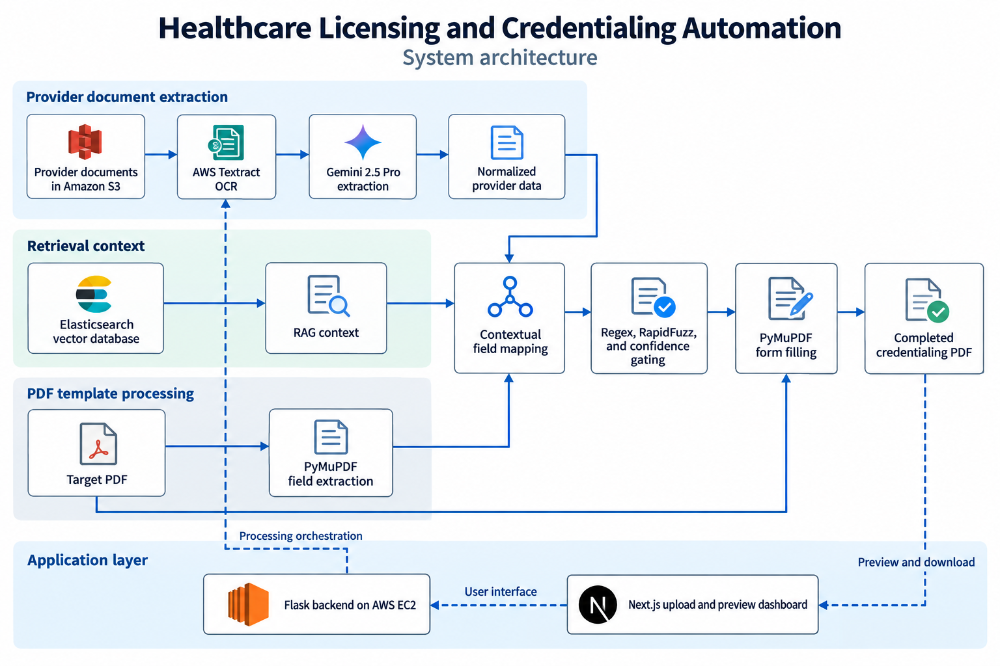

# AI Agent for Healthcare Licensing and Credentialing Automation

   
   
 

I built this project to turn healthcare provider documents into completed licensing and credentialing PDFs. My workflow combines AWS Textract OCR, Gemini 2.5 Pro, retrieval-augmented generation (RAG) over Elasticsearch, and deterministic validation to extract provider information, map it to form fields, and generate ready-to-submit documents.

I designed the data ingestion pipeline, modular Flask backend, Next.js upload and PDF preview dashboard, and AWS EC2/S3 deployment. My project connects full-stack software engineering with document processing and data quality, achieving **85% field-level accuracy** and **70% faster processing**.

## Table of Contents

- [Introduction](#introduction)
- [Results and Impact](#results-and-impact)
- [Software Architecture and System Design](#software-architecture-and-system-design)
- [Features and Tech Stack](#features-and-tech-stack)
- [Getting Started](#getting-started)
- [Usage Examples](#usage-examples)
- [Development and Testing](#development-and-testing)
- [Roadmap and Contributing](#roadmap-and-contributing)
- [Contact](#contact)

## Introduction

Healthcare licensing and credentialing applications repeatedly request the same provider information across lengthy forms. Manually transferring names, contact details, education, and license history creates repetitive work and opportunities for inconsistent data.

I built a reusable workflow that separates document extraction, provider-data validation, form-field mapping, and PDF generation. Instead of relying exclusively on an LLM, I combined contextual interpretation with OCR evidence, regex-based semantic heuristics, and fuzzy matching. I also rebuilt the upload and preview experience in Next.js to improve page load performance.

## Results and Impact

| Outcome | Result | My implementation |
| --- | --- | --- |
| Field extraction and population | **85% field-level accuracy** | AWS Textract OCR and Gemini 2.5 Pro for multi-page forms |
| Processing speed | **70% faster processing** | Contextual mapping combined with regex-based semantic heuristics |
| Manual review | **40% less review effort** | Normalization, RAG over Elasticsearch, and confidence gating |
| System reliability | **60% fewer system errors** | Modular Flask processing and AWS EC2/S3 workflow |
| Dashboard performance | **40% lower page load time** | Next.js server-side rendering and lazy-loaded PDF rendering, compared with my initial client-rendered React prototype |

These are the project results documented in my resumes. The local checks below verify component behavior; they do not reproduce the original performance evaluation.

## Software Architecture and System Design

The architecture below summarizes the system I built, including the retrieval and cloud deployment described in my project results.



### Component responsibilities

- **Ingestion and extraction:** I used S3 for provider documents and Textract for text, key-value pairs, and tables. Gemini converts that context into structured provider records.
- **Data quality and retrieval:** I combined normalized records and Elasticsearch retrieval with validation and confidence gating to reduce manual review.
- **Mapping and generation:** I extracted PDF widget labels, types, and coordinates with PyMuPDF, mapped them to provider values, and populated supported widgets.
- **Application layer:** I built the Flask backend and Next.js dashboard around uploads, processing, and PDF preview, with deployment on AWS EC2/S3.

### Local entry points

This checkout exposes the four PDF-processing stages as standalone Python scripts. Its Flask server currently provides welcome, health, and example endpoints. Next.js includes an S3 upload-URL route and PDF preview components. Start these components independently and use the CLI workflow below to process documents locally. Starting both servers does not automatically connect the dashboard to the processing scripts. Elasticsearch provisioning and retrieval configuration are not included in this checkout's quick start.

## Features and Tech Stack

| Capability | Technologies | What I implemented |
| --- | --- | --- |
| Document ingestion and OCR | Python, AWS Textract, Amazon S3 | Extraction of document text, tables, and key-value evidence |
| Semantic interpretation | Gemini 2.5 Pro | Structured provider extraction and contextual field mapping |
| Retrieval and data validation | RAG, Elasticsearch, regex, RapidFuzz | Provider-data normalization, contextual retrieval, and matching fallbacks |
| PDF processing | PyMuPDF | Field discovery, widget matching, and form population |
| Backend and cloud | Flask, AWS EC2/S3 | Modular processing and encrypted provider-upload workflow |
| Upload and preview dashboard | Next.js, React.js, TypeScript, react-pdf | Document upload interface and lazy-loaded PDF rendering |

I kept extraction, mapping, and filling separate so each stage produces an inspectable artifact. This makes it easier to diagnose whether an incorrect value originated in the source document, provider record, or target-field mapping.

## Getting Started

### Prerequisites

- Git, Python 3.10+, and Node.js 22.3+ with npm.
- AWS credentials with access to your S3 input document and Textract document-analysis operations in the selected region.
- A Gemini API key with access to the configured `gemini-2.5-pro` model.
- A provider document in S3 and a local PDF containing fillable form widgets.
- Google OAuth client credentials if you use the existing frontend sign-in route.

### 1. Clone and install backend dependencies

```bash
git clone https://github.com/AdishPadalia26/AI-agent-for-healthcare-licensing-and-credentialling.git
cd AI-agent-for-healthcare-licensing-and-credentialling/backend
python -m venv .venv
```

Activate the environment using the command for your shell:

```powershell
# Windows PowerShell
.\.venv\Scripts\Activate.ps1
```

```bash
# macOS or Linux
source .venv/bin/activate
```

Then install the declared backend requirements and additional packages imported by the pipeline:

```bash
python -m pip install -r requirements.txt
python -m pip install boto3 google-generativeai PyMuPDF rapidfuzz python-dateutil
```

The requirements file currently covers Flask, flask-cors, and python-dotenv. The second command supplies the standalone pipeline dependencies. If using the optional `cv_process.py` utility, also install `pdfplumber`.

### 2. Configure extraction and mapping

Create `backend/config/.env`. Commands in this section run from `backend/`, so the extractor resolves this as `config/.env`.

```dotenv
AWS_ACCESS_KEY_ID=replace_with_aws_access_key
AWS_SECRET_ACCESS_KEY=replace_with_aws_secret_key
AWS_DEFAULT_REGION=us-east-1
GEMINI_API_KEY=replace_with_gemini_api_key
# Add AWS_SESSION_TOKEN when using temporary AWS credentials.
```

The extraction script loads `GEMINI_API_KEY` from that file. The mapper reads `GOOGLE_API_KEY` from the process environment and does not load the file itself. Set the same Gemini key in the terminal that will run mapping:

```powershell
# Windows PowerShell
$env:GOOGLE_API_KEY = "replace_with_gemini_api_key"
```

```bash
# macOS or Linux
export GOOGLE_API_KEY="replace_with_gemini_api_key"
```

### 3. Configure and start the frontend

In a separate terminal, open `frontend/` and create `.env.local`:

```dotenv
AWS_REGION=us-east-1
AWS_ACCESS_KEY_ID=replace_with_aws_access_key
AWS_SECRET_ACCESS_KEY=replace_with_aws_secret_key
AWS_S3_BUCKET_NAME=replace_with_bucket_name
GOOGLE_CLIENT_ID=replace_with_google_oauth_client_id
GOOGLE_CLIENT_SECRET=replace_with_google_oauth_client_secret
NEXTAUTH_SECRET=replace_with_random_secret
```

The frontend's S3 helper explicitly uses the access key and secret shown above. Configure the bucket's CORS rules to allow uploads from your local frontend origin when exercising the presigned upload route. Keep credentials in the server-side environment files.

```bash
npm ci
npm run dev
```

Open [the local frontend](http://localhost:3000). Its upload page is available at `/upload`.

### 4. Start and verify Flask

In the activated backend environment:

```bash
python app.py
```

Visit [the health endpoint](http://localhost:5000/api/health). Expected response:

```json
{"status": "healthy", "service": "backend"}
```

The provided Flask command starts a development server with debug mode enabled.

## Usage Examples

### Run the document-to-PDF pipeline

Run these commands from `backend/` with the virtual environment active. Replace the bucket, S3 object key, and `form.pdf` with your inputs. Use a UTF-8 shell such as PowerShell 7 or Bash when redirecting extraction output to JSON.

```bash
# 1. Extract provider information from a document already stored in S3.
python -X utf8 0_textract_cv_data.py --bucket YOUR_BUCKET --key provider.pdf --region us-east-1 > output.json

# 2. Discover widgets and labels in the target PDF.
python 01_extract_fields.py --pdf form.pdf --out fields.json

# 3. Map provider values to fields using the configured GOOGLE_API_KEY.
python 02_map_fields_gemini.py --fields fields.json --resume output.json --out mapped_fields.json --min-confidence 0.50

# 4. Populate supported PDF widgets.
python 03_fill_pdf.py --pdf form.pdf --mapped mapped_fields.json --out filled_form.pdf
```

| Artifact | Contents |
| --- | --- |
| `output.json` | Provider record, critical-field provenance, and extracted context |
| `fields.json` | PDF field IDs, labels, types, zero-based pages, and bounding boxes |
| `mapped_fields.json` | Selected provider keys, raw values, normalized values, and confidence |
| `filled_form.pdf` | Populated PDF for visual review |

### Inspect intermediate data

This synthetic excerpt illustrates the extraction output. It is not a real provider record.

```json
{
  "full_name": "Dr. Jane Example",
  "contact_information": {
    "email": "provider@example.com",
    "phone": "2025550148"
  },
  "_provenance": {
    "contact_information.phone": {
      "source": "llm",
      "confidence": 0.9
    },
    "llm_model": "gemini-2.5-pro"
  }
}
```

A corresponding synthetic mapping excerpt shows phone normalization. Actual IDs and coordinates come from the target PDF.

```json
[
  {
    "id": "synthetic-phone-field",
    "page": 0,
    "field_name": "phone",
    "field_type": "text",
    "bbox": [72, 144, 240, 164],
    "label": "Phone",
    "chosen_key": "contact_information.phone",
    "raw_value": "2025550148",
    "value": "(202) 555-0148",
    "confidence": 0.92
  }
]
```

Mappings below `--min-confidence` receive null keys and values. The filler skips empty or null values, leaving those widgets available for review.

## Development and Testing

### Repository layout

```text
backend/
  app.py                    Flask development server
  requirements.txt          Flask application dependencies
  0_textract_cv_data.py      Provider extraction and reconciliation
  01_extract_fields.py      PDF widget and label discovery
  02_map_fields_gemini.py    Semantic mapping and normalization
  03_fill_pdf.py             PDF population
frontend/
  src/app/                  Next.js pages and API routes
  src/lib/s3.ts             Server-side S3 client
  package.json              Frontend commands and dependencies
```

This checkout has no configured automated test suite. For local verification:

- Check `/api/health` after starting Flask.
- Run `npm run build` from `frontend/` to check the production build.
- Process a synthetic provider document and a fillable PDF through all four stages.
- Inspect provenance, selected keys, and normalized phone/date values in the JSON artifacts.
- Confirm low-confidence mappings remain null and open the filled PDF to inspect placement, checkboxes, and text.

Extraction provenance includes heuristic confidence values; mapping confidence is model-estimated. Neither is a calibrated probability. If widget extraction returns no fields, confirm the input PDF contains interactive widgets. If mapping authentication fails, confirm `GOOGLE_API_KEY` is set in the current terminal.

## Roadmap and Contributing

### Completed milestones

- [x] Built the OCR-to-structured-provider-data pipeline.
- [x] Implemented contextual mapping, validation, and PDF generation.
- [x] Added RAG over Elasticsearch and confidence-gated processing.
- [x] Built the Flask and Next.js workflow and AWS EC2/S3 deployment.
- [x] Improved dashboard performance with server-side rendering and lazy-loaded PDF rendering.

For improvements to my project, open an issue describing the behavior, expected result, and relevant component. Pull requests should explain the change and how it was checked. Use synthetic documents and omit credentials or provider information from shared examples.

## Contact

**Author:** Adish Padalia

- **Email:** [padaliaadish@gmail.com](mailto:padaliaadish@gmail.com)
- **LinkedIn:** [adish-padalia-a3768a230](https://www.linkedin.com/in/adish-padalia-a3768a230/)
- **GitHub:** [AdishPadalia26](https://github.com/AdishPadalia26)
- **Portfolio:** [adish-padalia-portfolio.vercel.app](https://adish-padalia-portfolio.vercel.app)
- **Google Scholar:** [Publications and citations](https://scholar.google.com/citations?user=spsQ3XsAAAAJ&hl=en)
